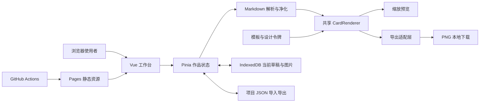

# MarkCard 技术开发说明书

> 版本：0.3 · 日期：2026-10-25 · 阶段：工作台重构与验证
> 对应 [项目说明书](project-guide.md) 中 FR-001–FR-014。初始工作区为空；现已完成首期应用代码和工作流。下文是设计约定，实际入口见 src/views/WorkspaceView.vue；运行方式与当前限制见根目录 README.md。用户要求保持本地 dev，暂不推送。

## 1. 技术约束与决策

| 决策                                             | 状态           | 依据与取舍                                                                 |
| ------------------------------------------------ | -------------- | -------------------------------------------------------------------------- |
| 使用指定 shadcnui-vue-simple-template 技能初始化 | 已确认         | Vue 3 + TypeScript + Vite + Pinia + Vue Router + Tailwind CSS + shadcn-vue |
| GitHub Actions 构建，GitHub Pages 托管 dist      | 已确认         | 交付静态站点，不依赖常驻进程                                               |
| 单长卡、手动分卡、PNG、约 12 套模板              | 已确认         | 不引入首期自动分页和多格式导出                                             |
| 无后端、无登录，IndexedDB 保存当前作品           | 按授权方案实施 | 适合静态部署；不具备云同步与账号隔离                                       |
| Vue Router hash history                          | 建议           | Pages 无需服务端重写，路由刷新无需 404 回退技巧                            |
| markdown-it + DOMPurify                          | 建议           | Markdown 解析与输出净化分离，原始 HTML 关闭                                |
| highlight.js 按需注册语言                        | 建议           | 代码高亮独立处理，限制首屏体积                                             |
| html-to-image 导出适配层                         | 候选方案       | 先验证字体、长图和 Safari；未通过关键样例前不视为已定型                    |

只确定技术类别，具体稳定版本在初始化时核对官方文档和 registry；用 `packageManager`、lockfile、Node 版本文件及 CI 固定执行环境。不得凭文档示例声称某版本已安装。

## 2. 系统结构与职责



首期没有业务 HTTP API、认证接口或数据库服务器。浏览器加载本站静态资源；外部链接仅在主动点击时访问。运行期不请求远程 Markdown 图片，也不内置代理、密钥或上传接口。

| 模块        | 职责                                              | 需求                  |
| ----------- | ------------------------------------------------- | --------------------- |
| editor      | Textarea 编辑、文件导入、分卡插入、输入限制       | FR-001、007、010      |
| markdown    | 解析、识别分卡 token、高亮、净化、资源地址校验    | FR-001、006、007、011 |
| templates   | 模板元数据、默认令牌和专属内容样式                | FR-002                |
| appearance  | 排版、背景、尺寸、署名覆盖值与重置                | FR-003–005            |
| renderer    | 共享卡片 DOM 和内容样式、资源加载状态             | FR-001–008            |
| export      | 快照、就绪检查、大小预检、顺序 PNG 生成、下载反馈 | FR-008                |
| persistence | 自动保存、草稿恢复、图片事务、备份迁移与清空      | FR-009–011、014       |
| workspace   | 响应式布局、键盘操作、状态反馈、应用外观          | FR-012                |
| delivery    | 类型检查、构建、检查工作流与 Pages 发布           | FR-013                |

## 3. 拟议目录与编码规范

```text
.github/workflows/       # ci.yml、deploy-pages.yml
docs/                   # 本次两份文档
public/                 # 自托管字体、示例资源（需授权）
src/
  App.vue               # 外壳与 RouterView
  main.ts               # 先注册 Pinia，再注册 router
  style.css             # Tailwind 入口与应用令牌
  router/index.ts       # createWebHashHistory
  views/WorkspaceView.vue
  components/ui/        # 官方 CLI 生成的 shadcn-vue 源码
  components/workspace/ # EditorPanel、PreviewPanel、PreviewCard、StylePanel、TemplateGallery
  components/card/      # CardRenderer、署名等
  stores/               # document、preferences，均为 setup store
  lib/utils.ts
  features/markdown/
  features/export/
  features/persistence/
  templates/            # 注册表、模板默认值、模板样式
  types/                # 作品与备份类型
AGENTS.md
components.json
package.json
pnpm-lock.yaml
vite.config.ts
tsconfig*.json
```

该目录是业务开发目标，实际初始化按指定技能先建立最小模板并验证 Pinia action，再演进为工作台；示例 counter 不是最终业务模型。SFC 使用 Composition API 与 `<script setup lang="ts">`，按 script、template、style 排列；`@/*` 在 TypeScript 与 Vite 中一致指向 `src/*`。派生预览、卡片数和有效样式使用 computed，watcher 仅承载保存等副作用。

### 强制 UI 约束

初始化时将指定模板技能的完整 UI 强制规范写入根目录 AGENTS.md，后续开发持续遵守。业务页面所有存在对应 shadcn-vue 组件的控件必须从 `@/components/ui/` 使用，不直接写原生 button/input/textarea/select/option/dialog，也不以 div 或其他组件库替代。Textarea 编辑器、Button 操作、Select 选项、Slider 数值、Switch 开关、Tabs 分区、Sheet 设置、Dialog 导入导出、AlertDialog 清空确认均按需通过官方 CLI 添加。

颜色使用带校验的 Input 输入 HEX 与由 Button 组成的预设色板，不擅自增加原生颜色输入。字号等数值用 Input 与 Slider 组合；署名日期用普通文字输入，不需要日期弹窗。需要日期选择时使用官方 Popover + Calendar 组合。文件导入先核对官方附件组件方案；如确有无法覆盖的控件缺口，按技能要求说明并取得用户同意后实现，不能偷偷绕开约束。

普通布局、标题、段落和卡片静态内容允许语义 HTML 与 Tailwind；净化后的 Markdown 使用限定渲染容器。模板不能附带交互脚本或任意用户 CSS。

## 4. 数据模型与生命周期

以下为建议 TypeScript 契约，不代表已有实现：

```ts
interface CardDocument {
  schemaVersion: 1
  id: string
  markdown: string
  templateId: string
  styleOverrides: Partial<CardStyle>
  signature: { visible: boolean; author: string; source: string; dateText: string }
  assetIds: string[]
  updatedAt: string // ISO 8601
}

interface CardStyle {
  width: number
  padding: number
  fontFamilyId: string
  fontSize: number
  lineHeight: number
  textColor: string
  accentColor: string
  backgroundId: string
  backgroundColor: string
  radius: number
  shadowId: string
  codeThemeId: string
}

interface LocalAsset {
  id: string
  mime: 'image/png' | 'image/jpeg' | 'image/webp'
  name: string
  blob: Blob
  width: number
  height: number
}
```

应用偏好（浅/深色、面板状态、默认导出倍率）与作品分离。卡片 HTML、分卡数组、导出 Blob、预览缩放不写入作品原始数据。有效样式等于模板默认值叠加已验证覆盖值；切换模板保留正文和署名，清除当前外观覆盖并通过提示说明，避免旧配色破坏新模板；选择模板前可取消操作。恢复模板默认值仅清空 styleOverrides。

IndexedDB 当前使用 draft、assets 两个对象存储；只保留当前草稿，更新作品与图片引用使用事务。应用主题独立保存在 localStorage，其他面板状态暂不持久化。编辑停止 600ms 后保存，记录实际成功时间，禁止在写入成功前展示“已保存”。加载失败暂停自动保存以保护原记录；配额不足/禁用存储时保留内存编辑并引导备份。不依赖关闭页面事件保证最后一次保存；未保存状态退出时尽力提示，移动端仍应告知可能丢失最近输入。

LocalAsset 的 Blob 为运行时结构；写入 IndexedDB 前将其转换为 ArrayBuffer，在同一事务中保存二进制与元数据，读取时还原 Blob，以适配无法直接存储 Blob 的 WebKit 环境。兼容读取早期本地实现留下的 Blob 字段。

图片引用使用应用内部资源标记，例如 ``，解析后仅由资源解析器替换为本应用生成的 Blob URL，不接受用户任意 blob/data URL。恢复与导入时重新创建 URL，替换或清空后释放。项目 JSON 采用 `{ format: 'markcard-project', schemaVersion: 1, document, assets }`，assets 保存可验证的 base64 字节；导出不携带运行时 Blob URL。

项目文件建议上限 35MB（考虑 base64 膨胀），解码后总图片仍按 20MB 限制。导入先校验格式、版本、字段白名单、范围、引用完整性和图片实际解码结果，再一次性替换；未知新版本拒绝并提示升级，不猜测转换。新增 schema 需显式迁移函数，迁移失败保留旧记录并提供备份。清空同时删除当前作品和所属图片，不影响应用偏好；提供单独恢复应用默认设置入口。

## 5. Markdown、分卡与模板渲染

建议 markdown-it 关闭原始 HTML，支持标题、列表、强调、引用、链接、表格、围栏代码和分隔线；不引入原始 HTML、公式、Mermaid 插件。链接限定 http/https/mailto，拒绝 javascript 等协议；新窗口链接补充 `noopener noreferrer`。高亮输出和 Markdown HTML 最后统一经 DOMPurify 白名单净化，净化后不再拼接不可信 HTML。方案依据见 [markdown-it 官方仓库](https://github.com/markdown-it/markdown-it) 与 [DOMPurify 官方仓库](https://github.com/cure53/DOMPurify)。

手动分卡用解析器块级规则识别独占一行的 `<!-- card-break -->`，只在顶层且围栏代码外生效，不能直接按字符串全局 split。测试连续、首尾、代码内标记、列表内标记和未闭合围栏；列表或引用中的标记按普通文字处理。分卡后按同一规则渲染，过滤空段并反馈，不使用 HTML 注释执行机制。

高亮建议首期注册 JS/TS、JSON、HTML/XML、CSS、Bash、Python、SQL；未知语言转义成纯文本。代码行启用保留空白与安全换行，避免滚动裁切。内容样式限定在 `.markcard-content`，与应用 UI 样式隔离；导出专用模式使表格、代码完整可见。

每个模板包含 id、名称、类别、默认 CardStyle 和静态内容样式；模板以默认 ToggleGroup 选择项内嵌在设置区。约 12 套模板以明确类名/CSS 变量注册，不通过运行时拼接无法被 Tailwind 扫描的任意类名。字体按白名单映射到系统字体或经授权自托管文件，不请求在线字体服务；装饰采用可导出的简单 CSS 与本地资源。

## 6. PNG 导出设计与验证门槛

预览与导出共同使用 CardRenderer。预览外层应用缩放；导出挂载独立、无缩放、非 display:none 的固定宽度 DOM，使用导出启动时的不可变作品快照，避免生成途中编辑影响不同卡片。导出候选库 [html-to-image](https://github.com/bubkoo/html-to-image) 提供 DOM 转图能力，但大 DOM、跨域资源和浏览器差异需验证，不承诺无限长图。

导出步骤：

1. 校验非空内容和设置，锁定快照，收集待导出的卡片。
2. 等待 Vue nextTick、字体就绪与图片 decode；资源失败时报告具体原因，不能忽略图片直接成功。
3. 测量无缩放 DOM，检查目标宽高与倍率；建议初始限制单边 16,384px、总像素 32MP，属项目保守策略而非浏览器通用上限，按实测可进一步降低。
4. 估算至少 `宽 × 高 × 倍率² × 4` 字节的单缓冲开销，说明实际还存在多个副本；手机优先 1×，超限提示分卡或降低倍率，不默认静默降质。
5. 顺序生成 PNG Blob 与下载链接，名称采用 `markcard-日期-序号.png`；释放每张临时 DOM 和 URL，避免一次并发生成所有大图。
6. 展示成功张数、失败卡片和重试入口；取消后终止后续任务，说明已下载文件不会被撤销。浏览器多下载限制提供逐张下载替代。

验证门槛：中文长文、粗斜体、Emoji、长代码、宽表格、本地透明 PNG、WebP、署名、渐变、阴影和全部模板；至少覆盖 Chromium、Firefox、Safari 和两类手机浏览器。若候选库无法满足关键用例，记录失败样例并重新评估导出适配器；先做这一技术验证，再投入全部模板精修。

## 7. 本地开发与模板初始化

实施时检查 Node/pnpm、目录冲突与现有 AGENTS.md，然后按指定技能用官方稳定 Vite Vue TS 模板初始化当前目录，配置 Pinia、Router 和 `@` 别名。使用官方 CLI 初始化 shadcn-vue 并添加组件，不手写 lockfile 或冒充 CLI 产物。

根据 [shadcn-vue Vite 安装文档](https://www.shadcn-vue.com/docs/installation/vite) 与 [Tailwind Vite 文档](https://tailwindcss.com/docs/installation/using-vite)，在初始化时再次核对命令、路径和依赖；Tailwind 使用当前 Vite 插件方案，保留 Vue 插件，全局入口导入 Tailwind。本文核对日期为 2026-10-25，未锁定未来初始化的具体版本。

约定脚本：`dev` 启动 Vite；`build` 包含 `vue-tsc -b && vite build`；`preview` 本地检查 dist。执行 `pnpm install` 后提交生成的 lockfile，CI 使用 `pnpm install --frozen-lockfile`。按模板要求忽略 node_modules、dist、环境文件、日志与编辑器本地文件，保留 lockfile、components.json、组件源码。Vite 环境变量会进入客户端产物，不能放令牌或密码。

## 8. GitHub Actions 与 Pages 自动部署

部署方案依据 [Vite 静态部署文档](https://vite.dev/guide/static-deploy.html#github-pages) 与 [GitHub Pages 自定义工作流文档](https://docs.github.com/en/pages/getting-started-with-github-pages/using-custom-workflows-with-github-pages)。仓库地址、默认分支和域名目前未知，下列为配置约定，不是已创建的工作流。

- 仓库 Pages 的发布源设为 GitHub Actions。`ci.yml` 对 PR 和主分支执行锁定安装、类型检查、必要测试与构建，PR 不部署生产环境。
- `deploy-pages.yml` 监听实际默认分支 push 与 workflow_dispatch；同一工作流先 build 后 deploy，部署 job 必须 needs 构建成功，不用互不依赖的工作流碰运气等待检查。
- 构建 job：checkout → 安装项目指定版本的 pnpm/Node → 依 lockfile 缓存 → frozen install → 检查与 build → configure-pages / upload-pages-artifact 上传 dist。各 action 的版本或提交 SHA 在实施时核对官方发布，不在本文固定过期版本。
- 部署 job 使用 github-pages environment，授予 `pages: write` 和 `id-token: write`，使用 deploy-pages；读取代码仅需 `contents: read`，避免给全流水线过宽权限。使用 Pages 并发组防止较旧构建覆盖新版本，输出 deployment page_url。
- 项目站点 `https://<owner>.github.io/<repo>/` 的 Vite base 必须为 `/<repo>/`；用户/组织根站点或自定义根域名用 `/`。名称大小写按实际路径设置，禁止先写死 owner 或假定仓库一定叫 MarkCard。
- Router 使用 `createWebHashHistory(import.meta.env.BASE_URL)`；静态资源通过 Vite 导入或 BASE_URL 组合，禁止写死 `/assets/...`。在带仓库前缀的地址验证脚本、字体、图片与 hash 路由刷新。
- 自定义域名仅在用户确定后配置 DNS、Pages 域名与 CNAME（如采用）；不要默认生成域名或承诺 DNS 已生效。

发布验证包括：首页打开、资源无 404、恢复草稿、切换模板、导出 PNG、手机访问和 hash 路由刷新。构建失败不替换现网。回滚采用 revert 引入问题的提交后重跑部署；IndexedDB schema 需向后兼容或提供受控迁移，回滚前检查数据版本，不以清空用户数据解决问题。

## 9. 安全、错误与质量验证

输入与备份均作为不可信数据：字段白名单、长度/范围限制、文件字节与解码验证、HTML 净化、协议校验。图片不得直接以用户文件名拼 HTML。远程图片不自动加载；禁止抓取第三方站点来绕过 CORS。默认不采集正文、图片或第三方遥测；本地错误信息只记录错误类型和模块，避免把正文写入控制台或日志。

错误分为：输入无效（保留当前有效数据）、存储失败（内存保留+备份）、资源未就绪（指出图片/字体）、导出超限（分卡/倍率建议）、部署失败（Actions 日志）。所有用户可恢复错误都有明确入口；不可用资源不能制造虚假“成功”。

| 验证层次             | 重点                                                           | 对应需求              |
| -------------------- | -------------------------------------------------------------- | --------------------- |
| 必需构建检查         | TypeScript、生产构建、依赖锁定、业务控件来源与 AGENTS 规则     | FR-012、013           |
| 有价值的逻辑测试     | 围栏内分卡、HTML/协议攻击、JSON 无效版本、导入不覆盖、像素超限 | FR-001、007、008、010 |
| 存储集成检查         | 保存恢复、图片事务、配额失败、迁移失败保留、清空后无旧图       | FR-009、011、014      |
| 浏览器操作与视觉检查 | 12 模板、设置、代码/表格完整、字体、手机、键盘、PNG 实际内容   | FR-002–006、008、012  |
| 发布检查             | PR 无部署、主分支成功后部署、子路径、刷新与回滚                | FR-013                |

不为每个静态 UI 写镜像测试；按上述关键风险选择必要测试工具并记录结果。性能目标与字符/图片上限见产品文档，测试时记录设备、浏览器、样例和实际耗时。解析预览建议 150ms 防抖，高亮按语言懒加载，导出库按需加载；只有实测发现卡顿才考虑 Worker，首期不预建复杂基础设施。

## 10. 实施顺序与待确认项

先完成模板最小构建与状态验证，再完成一套模板从编辑到安全渲染、分卡和 PNG 的垂直闭环；通过导出技术门槛后扩展至 12 套模板，接入本地保存与备份，最后完成跨浏览器验证与 Pages 工作流。

本地已采用纯前端无登录方案，仓库 origin 为 `https://github.com/yeyongzhi/MarkCard.git`，当前分支 `dev`。暂不提交或推送。依赖版本由 package.json、pnpm-lock.yaml 与 .node-version 记录；首期仅用系统字体。未来发布前确认远程默认分支与域名；当前工作流监听 main，并通过 configure-pages 的 base_path 适配实际站点地址。自动化测试包含 Chromium、Firefox 与 WebKit；真实 iOS/Android 设备和 macOS Safari 仍需发布前实机验证。若后续增加账号云同步，需另行设计后端、权限和数据迁移。
